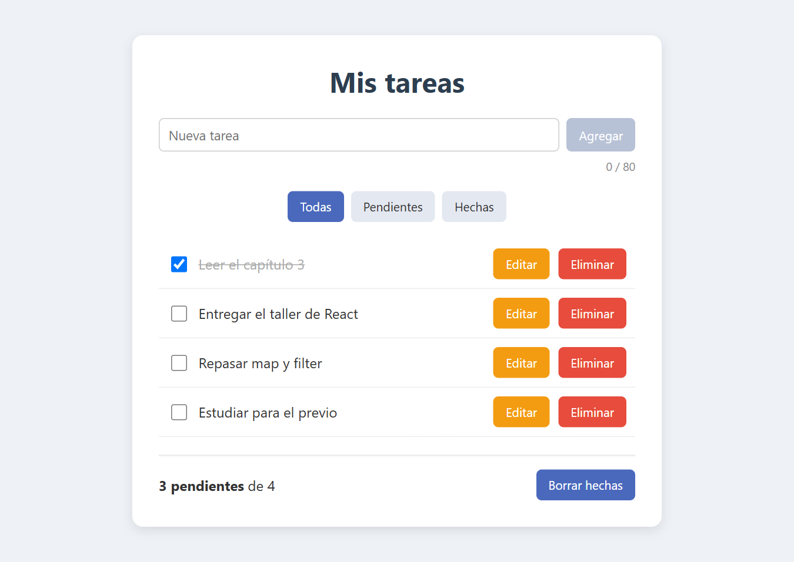

# ✅ Mis tareas · CRUD en React


Lista de tareas hecha con **React + Vite** para practicar el CRUD completo (crear, leer, actualizar y eliminar) con estado en memoria, componentes y props. Las tareas se guardan en el navegador con `localStorage`, así que no se pierden al recargar.

<p align="center">
  
</p>

## ✨ Qué hace

- ➕ **Agregar tareas** con un contador de caracteres (máximo 80). Si el texto está vacío o es muy largo, el botón se desactiva.
- ☑️ **Marcar como hecha o pendiente** con una casilla. Las hechas se ven tachadas.
- ✏️ **Editar** cada tarea con los botones *Guardar* y *Cancelar*.
- 🗑️ **Eliminar** con confirmación antes de borrar.
- 🔍 **Filtrar** entre *Todas*, *Pendientes* y *Hechas*.
- 📊 **Resumen** de cuántas quedan pendientes, con un botón para borrar todas las hechas.
- 💾 **Persistencia** con `localStorage`.

## 🚀 Cómo correrlo

Necesitas [Node.js](https://nodejs.org/es/download) instalado.

```bash
npm install
npm run dev
```

Luego abre la dirección que muestra la terminal (normalmente http://localhost:5173).

## 🗂️ Estructura

```
src/
├── App.jsx                  ← estado de las tareas y funciones del CRUD
├── App.css                  ← estilos de los componentes
├── index.css                ← estilos generales
└── components/
    ├── FormularioTarea.jsx  ← input para agregar + contador
    ├── Filtros.jsx          ← botones Todas / Pendientes / Hechas
    ├── ListaTareas.jsx      ← recorre la lista con map
    ├── Tarea.jsx            ← una tarea: marcar, editar y eliminar
    └── Resumen.jsx          ← pendientes y "Borrar hechas"
```

## 📚 Lo que practiqué

- `useState` para el estado de la lista, el filtro y el modo edición.
- Pasar datos y funciones entre componentes con **props**.
- Actualizar el estado sin mutarlo usando `map`, `filter` y el operador *spread* (`...`).
- Formularios controlados y validación sencilla.
- Guardar y leer datos con `localStorage` usando `JSON.stringify` y `JSON.parse`.

El taller se hizo por pasos (del Paso 0 al Paso 9) y cada paso tiene su propio commit en el historial.

---

Hecho por **David Camilo Colmenares**, estudiante de Ingeniería de Sistemas en la UFPS. [GitHub](https://github.com/Camilo0812A)
